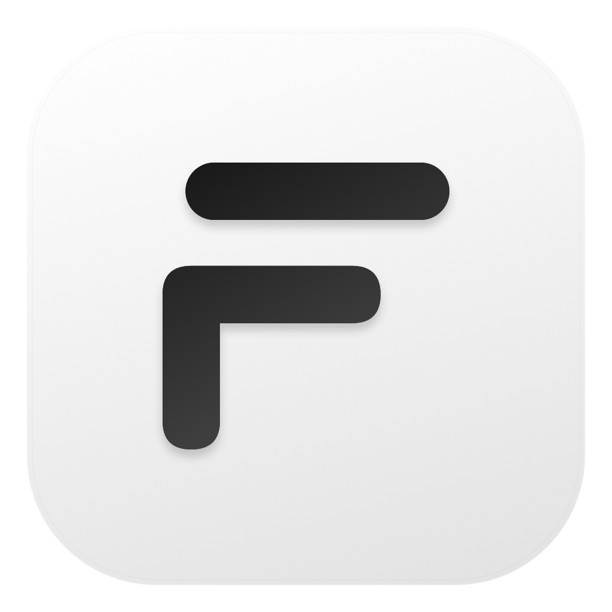
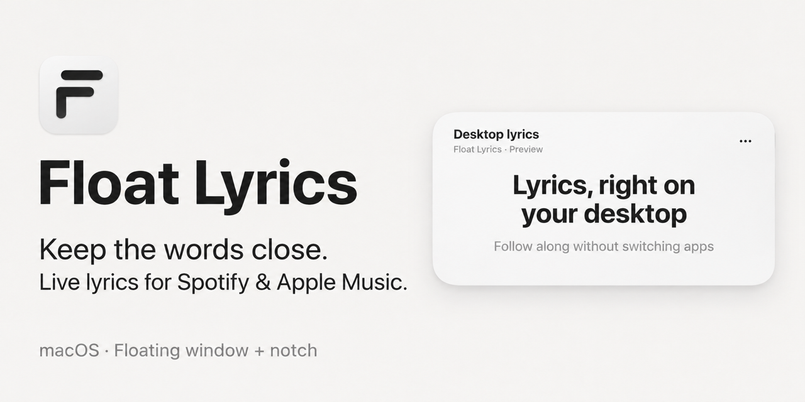
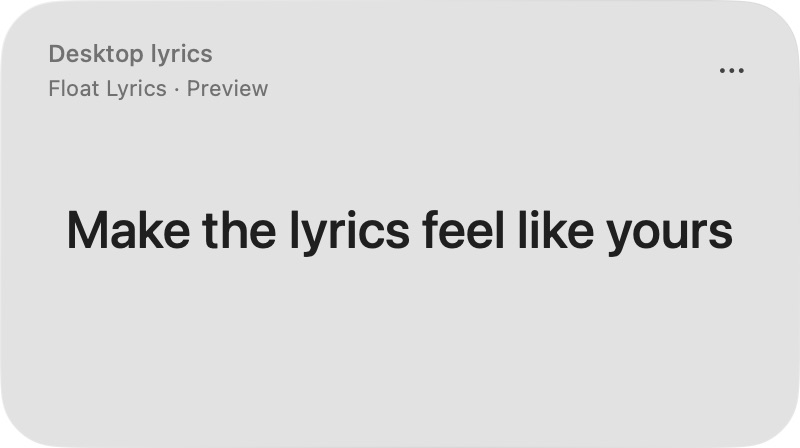
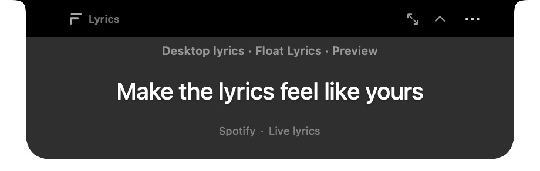
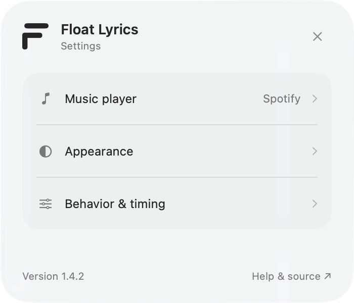
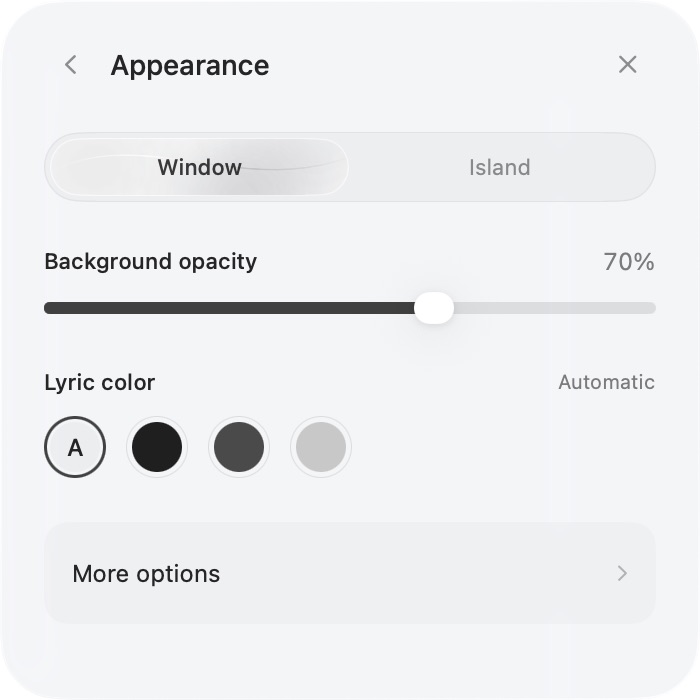

<p align="center">
  
</p>

<h1 align="center">Float Lyrics</h1>

<p align="center"><strong>Keep the words close.</strong><br>
Live lyrics for Spotify and Apple Music, quietly beside your work.</p>

<p align="center">
  <a href="https://github.com/WYSIATI/FloatLyrics/releases/latest/download/Float-Lyrics.dmg"><strong>Download for macOS →</strong></a>
  &nbsp;·&nbsp; <a href="https://github.com/WYSIATI/FloatLyrics/releases">Releases</a>
</p>

<p align="center"><sub>macOS 14+ &nbsp;·&nbsp; Apple Silicon & Intel &nbsp;·&nbsp; Free & open source</sub></p>



Your song keeps playing. The current line follows along in a small floating
window, or tucks into your Mac's notch. Stay with your work and catch the words
with a glance.

| Beside your work | In your notch | Your own rhythm |
| --- | --- | --- |
| A small window that stays on top without taking focus. | A single lyric line at the top of your screen. Click for more. | Separate opacity and text colors for the window and island. |

## Screenshots

Native app captures with original demo text. Click an image for full resolution.

**Floating window** — the current lyric, song details and the options menu.

<a href="docs/screenshots/floating-window.png"></a>

**Dynamic Island** — a compact line at the screen edge; click to expand for song
details and the controls to return to the window or collapse the island.

<a href="docs/screenshots/island-compact.png"></a>

<a href="docs/screenshots/island-expanded.png"></a>

| Settings | Appearance |
| --- | --- |
| <a href="docs/screenshots/settings.png"></a> | <a href="docs/screenshots/appearance.png"></a> |

The social card above is a composed brand illustration. These screenshots are
captures of the app itself. [Capture notes and refresh instructions](docs/screenshots/README.md).

## Install

1. Download and open **Float-Lyrics.dmg**.
2. Drag **Float Lyrics** to **Applications**, then open the app.
3. Choose **Music Player → Spotify** or **Apple Music** from **•••**, play a song
   in that desktop app, and allow macOS Automation when asked.

Updating from the previous name? Quit **FloatLyrics**, move the old
**FloatLyrics.app** out of Applications, and install **Float Lyrics.app**.
Your saved preferences are retained.

For future updates, choose **Check for Updates…** from the menu-bar menu or
Settings. The app checks the latest public GitHub release and offers its
installer and release notes. Download opens your browser; quit Float Lyrics,
open the downloaded installer, and replace the copy in Applications. Your
settings are kept.

Requires **macOS 14+**, with a universal Apple Silicon/Intel build. Native Liquid
Glass is available on **macOS 26+**; earlier systems use a translucent material.

**Signed and notarized:** Float Lyrics **1.5.0** is signed by **Mini Motion AI
LLC**, notarized by Apple, and includes stapled verification tickets for both
the app and installer. The mounted installer uses the same lifted-line F logo
as the app. Download only from this repository's Releases page and compare the
[SHA-256 checksums](https://github.com/WYSIATI/FloatLyrics/releases/download/v1.5.0/SHA256SUMS.txt).
You can also build from source.

To replace an older preview that macOS blocked, quit Float Lyrics, download
the DMG using the link above, open it, and drag **Float Lyrics** into
**Applications**, choosing **Replace**. Eject the
installer and open the app from **Applications**. The older unnotarized
downloads are still available in past releases; use **1.4.2 or later** for
Apple-verified installation.

## A small companion

- **A glance, then back to work.** The 400 × 224 point window shows the song,
  current line, next line and one menu. It stays on top without taking focus.
- **A line in your notch.** Dynamic Island joins the camera housing, with a
  24-point lyric extension and a default width of 320 points. Click to expand;
  it shrinks when you return to work. No-notch displays use a top-edge island.
- **Your player, in time.** Local Spotify and Apple Music playback drive free
  LRCLIB lookups, with pause/seek updates, cached lyrics and retry states.
- **Make it comfortable.** Settings starts with three choices.
  Appearance holds opacity and neutral text colors; More options holds custom
  colors, material, type size and island layout.

Open Settings from **•••**, the menu bar, or **⌘,**. Window and Island have separate
opacity and text preferences. Only the background fades; lyrics stay crisp.
Always-on-top, click through and lyric timing live under Behavior & timing.
The menu bar restores access when lyrics are hidden or click through is enabled.

Choose **••• → Hide Window** to put the floating window away. The menu-bar icon
stays visible: choose **Show Window** to bring it back; the same item becomes
**Hide Window** while it is visible. Hiding preserves your display mode.

To toggle lyrics while working in another app, open **Settings → Behavior &
timing → Show / hide lyrics**, click **Record Shortcut**, and press your preferred
combination. The shortcut is saved across launches; use its clear button to
disable it. No global shortcut is assigned until you choose one. In island mode,
the same shortcut hides and restores the island.
For a letter shortcut, include **Command**, **Control** or **Option**; for example,
**Control + Option + H**. You can add Shift, but **Shift + H** alone is not supported.

To quit, choose **••• → Quit Float Lyrics** in the floating window. In notch
mode, click the island to expand it, then choose **••• → Quit Float Lyrics**.
The menu-bar menu also includes Quit.

## Privacy and limitations

No account, analytics, event taps or Accessibility permission is required.
macOS Automation reads the selected player's track and position. Only the
current track's **title, artist, album and duration** are sent to
[LRCLIB](https://lrclib.net/docs) over HTTPS. Lyrics are cached locally.
Clicking **Check for Updates…** also contacts GitHub over HTTPS to read the
latest public release. Update checks send no playback metadata or preferences.

Some recordings have no lyrics or only untimed lyrics, which are explicitly
shown as unsynced. Browser players, Spotify Connect playback on another device
and radio streams without usable metadata are outside the supported path.

Live Spotify playback was checked on the development Mac. Apple Music's
scripting integration was compiled against its installed dictionary; an active
Apple Music playback session, Intel execution and older-macOS material rendering
have not been tested end to end. See [validation](docs/VALIDATION.md).

## Build and contribute

Use **Xcode 26 or newer**. The Swift 6 / SwiftUI / AppKit app uses the MIT-licensed
[KeyboardShortcuts](https://github.com/sindresorhus/KeyboardShortcuts) package for
global shortcut recording and handling. Swift Package Manager resolves the
pinned version; the app build script includes its resources and license.

```sh
swift test
ARCHITECTURE=native bash scripts/build-app.sh
open "build/Float Lyrics.app"

# Universal test installer with matching logo (not notarized):
DISTRIBUTION=preview bash scripts/package-dmg.sh
DISTRIBUTION=preview bash scripts/verify-dmg.sh
```

Preview installers go in `dist/preview/`. Release packaging requires Developer
ID signing and Apple notarization; see [the setup guide](docs/RELEASING.md).

For visual previews with original product-demo text, launch the executable with `--demo`.
`--demo-position 15` starts at a chosen sample time. Preview preferences are
separate from listening preferences. `--diagnostics` prints opt-in playback
diagnostics.

Visibility and shortcut configuration emit native debug logs under subsystem
`app.floatlyrics.desktop`, category `WindowPresentation`, viewable in Console.
These messages contain display state only, without song details or key combinations.
Manual update checks use category `Updates` for request, completion and error logs.

`--recording-preview` uses real desktop-player playback with isolated appearance
preferences for screen recording; it does not substitute sample lyrics.

[Contributing](CONTRIBUTING.md) · [Security](SECURITY.md) ·
[Release/signing instructions](docs/RELEASING.md) · [Changelog](CHANGELOG.md)

## Credits

[LRCLIB](https://lrclib.net) supplies lyrics. The notch interaction was inspired
by [Vibe Notch](https://github.com/farouqaldori/vibe-notch). Motion studies by
[Chahat Soni](https://dribbble.com/shots/27633863-Liquid-metal-button-in-Figma) and
[Konpo](https://dribbble.com/shots/25673199-Konpo-Liquid-Metal-Effect-on-Our-Logo)
informed earlier explorations; no reference media is bundled.

[MIT license](LICENSE). Third-party lyrics and trademarks retain their owners'
rights. Float Lyrics is independent of Apple, Spotify, Manus and Cue.
[Full notices](NOTICE.md).
