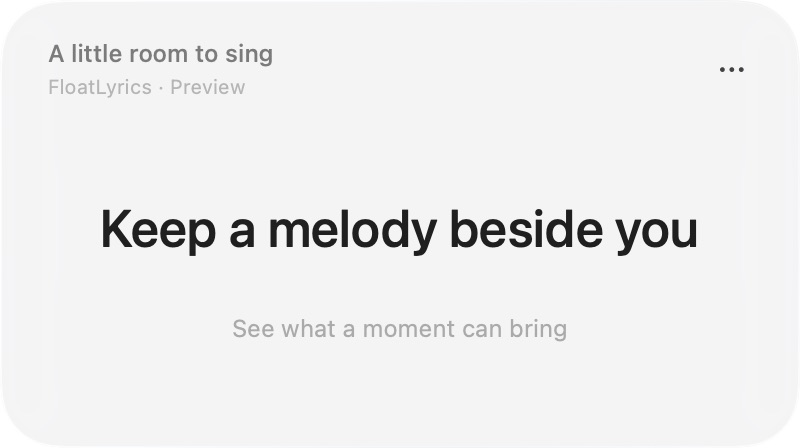

# Float Lyrics

**Keep working. Keep the words close.**

A small, native macOS lyrics companion for Spotify and Apple Music. The current
line floats beside your work, or tucks into your Mac's notch.

[**Download for macOS →**](https://github.com/WYSIATI/FloatLyrics/releases/latest/download/Float-Lyrics.dmg)
· [All releases](https://github.com/WYSIATI/FloatLyrics/releases)
· [Launch film](https://github.com/WYSIATI/FloatLyrics/releases/latest/download/Float-Lyrics-launch.mp4)



## Install

1. Download the DMG and drag **Float Lyrics** to **Applications**.
2. Open it. Choose **Music Player → Spotify** or **Apple Music** from **•••**.
3. Play a song in that desktop app and allow macOS Automation when asked.

Requires **macOS 14+**, with a universal Apple Silicon/Intel build. Native Liquid
Glass is available on **macOS 26+**; earlier systems use a translucent material.

**Public preview:** the download is ad-hoc signed and **not notarized**. After an
initial launch attempt, macOS may require **System Settings → Privacy & Security
→ Open Anyway**. Download only from this repository's Releases page. The release
includes [SHA-256 checksums](https://github.com/WYSIATI/FloatLyrics/releases/latest/download/SHA256SUMS.txt).
You can also build from source.

## Quiet by default

- **A glance, then back to work.** The 400 × 224 point window shows the song,
  current line, next line and one menu. It stays on top without taking focus.
- **A line in your notch.** Dynamic Island joins the camera housing, with a
  24-point lyric extension and a default width of 320 points. Click to expand;
  it shrinks when you return to work. No-notch displays use a top-edge island.
- **Your player, in time.** Local Spotify and Apple Music playback drive free
  LRCLIB lookups, with pause/seek updates, cached lyrics and retry states.
- **Adjust only when you want to.** Settings starts with three choices.
  Appearance holds opacity and neutral text colors; More options holds custom
  colors, material, type size and island layout.

Open Settings from **•••**, the menu bar, or **⌘,**. Window and Island have separate
opacity and text preferences. Only the background fades; lyrics stay crisp.
Always-on-top, click through and lyric timing live under Behavior & timing.
The menu bar restores access when lyrics are hidden or click through is enabled.

## Privacy and limitations

No account, analytics, event taps or Accessibility permission is required.
macOS Automation reads the selected player's track and position. Only the
current track's **title, artist, album and duration** are sent to
[LRCLIB](https://lrclib.net/docs) over HTTPS. Lyrics are cached locally.

Some recordings have no lyrics or only untimed lyrics, which are explicitly
shown as unsynced. Browser players, Spotify Connect playback on another device
and radio streams without usable metadata are outside the supported path.

Live Spotify playback was checked on the development Mac. Apple Music's
scripting integration was compiled against its installed dictionary; an active
Apple Music playback session, Intel execution and older-macOS material rendering
have not been tested end to end. See [validation](docs/VALIDATION.md).

## Build and contribute

Use **Xcode 26 or newer**. The Swift 6 / SwiftUI / AppKit app has no third-party
runtime dependencies.

```sh
swift test
ARCHITECTURE=native bash scripts/build-app.sh
open "build/Float Lyrics.app"

# Universal installer, stable download alias and checksums:
bash scripts/package-dmg.sh
bash scripts/verify-dmg.sh
```

For original-lyrics visual previews, launch the executable with `--demo`.
`--demo-position 15` starts at a chosen sample time. Preview preferences are
separate from listening preferences. `--diagnostics` prints opt-in playback
diagnostics.

[Contributing](CONTRIBUTING.md) · [Security](SECURITY.md) ·
[Release/signing instructions](docs/RELEASING.md) · [Changelog](CHANGELOG.md)

## Credits

[LRCLIB](https://lrclib.net) supplies lyrics. The notch interaction was inspired
by [Vibe Notch](https://github.com/farouqaldori/vibe-notch). Motion studies by
[Chahat Soni](https://dribbble.com/shots/27633863-Liquid-metal-button-in-Figma) and
[Konpo](https://dribbble.com/shots/25673199-Konpo-Liquid-Metal-Effect-on-Our-Logo)
informed earlier explorations; no reference media is bundled.

[MIT license](LICENSE). Third-party lyrics and trademarks retain their owners'
rights. Float Lyrics is independent of Apple, Spotify, Manus and Cue.
[Full notices](NOTICE.md).
